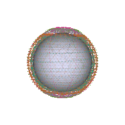

# Animation Only

Start with the [handbook animation guide](../docs/handbook/12-animation.md).
It explains local Python/VTK setup, a small example, the display legend,
timing, shutdown, and the differences between animation and full emulation.

With the local Python environment and animation dependencies installed, run
from the QUEST repository root:

```sh
python3 animate.py quickstart/quickstart.toml
```



The image above is an inherited illustration, not output from the current
quickstart. The viewer is a geometry preview: it does not apply QUEST's shared
antenna scheduler, visualize contact-based VM activation, or draw direct
ground-station backhaul.

This directory contains inherited example configurations: `iridium.toml`,
`kuiper.toml`, `oneweb.toml`, `starlink.toml`, and `geostationary.toml`. They are
model examples, not verified current operational constellations. Check their
size and duration before running a larger example:

```sh
# in root directory
python3 animate.py ./animation/starlink.toml
```

Stop with `Ctrl+C` in the launching terminal. Closing the window alone may
leave the animation process running.
