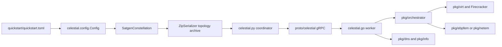

# 5. System Architecture

QUEST separates work that happens before a run from the privileged runtime.
The same distinction helps you decide where a bug or measurement belongs.
Configuration uses Tom's Obvious Minimal Language (TOML), and coordinator to
worker control uses gRPC, a remote procedure call framework.

## Architectural overview



## Build plane

The build plane creates executable artifacts but does not calculate or run a
constellation.

| Path | Responsibility | Output |
| --- | --- | --- |
| `compile.Dockerfile`, `celestial-make` | pinned protobuf/extended Berkeley Packet Filter (eBPF)/Go toolchain | generated bindings and `celestial.bin` |
| `builder/` | constructs an Alpine-based guest root filesystem | `.img` root filesystem |
| `kernel/` | required kernel can be directly downloaded; keeps its configuration for reference | `vmlinux-5.12.bin`guest kernel |
| `Makefile` | records supported build commands | local generated artifacts |


A successful image build proves that an artifact can be
constructed. It does not prove that the remote host has KVM or that the
application behaves correctly inside a microVM.

## Topology-generation plane

`satgen.py` loads TOML and constructs `celestial.config.Config`. Configuration
validation occurs before orbital work. `SatgenConstellation` creates each
`Shell`, all machine descriptions, the antenna scheduler, and any direct
ground-station backhaul links.

For every timestep, each shell calculates positions and all physically valid
contacts. The shared `AntennaScheduler` then selects contacts across shells for
each ground station. Each shell applies the selected contacts, activation,
routes, and differences. `ZipSerializer` writes only initial state and changes
needed by the runtime.

## Coordination plane

The Python coordinator is a deterministic replay process:

1. `ZipDeserializer` restores the validated configuration and initial
   machines.
2. `celestial.py` creates one `Host` object for each worker address.
3. Workers register and exchange peering information.
4. Initial machines are assigned round-robin and sent in one initialization
   request.
5. Machine/link differences are converted into streamed gRPC updates at each
   configured timestep.
6. The coordinator sends `Stop` when the duration ends or it is interrupted.

The coordinator follows wall-clock time after initialization and
prepares the next update before its target timestep.

## Worker runtime plane

`celestial.go` selects an eBPF or netem backend, initializes peering and
virtualization, registers the gRPC service, and starts DNS and HTTP information
services.

`pkg/server` translates protocol messages into the Go types used by
`pkg/orchestrator`. The orchestrator owns the current machine and network
state. Its virtualization interface is implemented by `pkg/virt`, which:

- assigns guest subnets and TAP devices;
- creates sparse writable overlays;
- configures and starts Firecracker;
- suspends/resumes active machines;
- routes remote machines through `pkg/peer`;
- delegates delay, bandwidth, and blocked state to `pkg/ebpfem` or
  `pkg/netem`.

`pkg/dns` resolves private `.celestial` names. `pkg/info` exposes current
machine, constellation, and path state to guests.

The Go worker uses `/celestial` for kernels, root images,
overlays, peering keys, and console output.

## Data contracts between planes

```text
TOML
  Config object
    ZIP: config + init records + machine/link diffs
      protobuf/gRPC requests
        Go MachineConfig and State
          Firecracker/network operations
```

The ZIP records emulator control state.
The gRPC schema is not a user-facing query protocol.
## Failure ownership

- TOML/schema error: configuration plane.
- Position/contact generation error: topology plane.
- ZIP parse or timing error: coordinator plane.
- gRPC registration/update error: coordination boundary.
- missing `/dev/kvm`, interface, or artifact: worker-host boundary.
- application exception or missing result: guest/rootfs boundary.
- wrong scientific conclusion despite a successful run: experiment design.

## Checkpoint

Draw the path from `antenna_number = 1` to a guest ping. Mark the
point where the antenna choice is calculated, serialized, transmitted, and
finally enforced as a blocked/unblocked network path.
