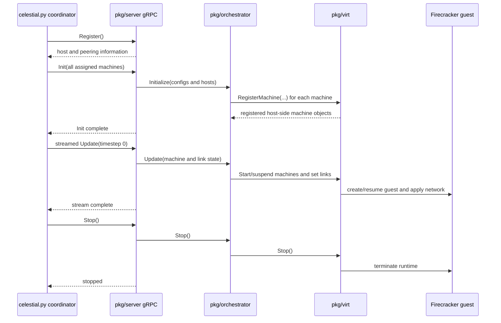

# 6. Startup Call Flow

This chapter follows actual entry points and symbols. “Source fact” names what
the checked-in code does. “Why it matters” gives teaching interpretation.

## Phase A: topology archive generation

This phase runs on the local workstation, either in the Python 3.11 virtual
environment or through the optional `satgen-docker` image.

```text
satgen.py
  → toml.load(input)
  → celestial.config.Config(text_config)
  → celestial.zip_serializer.ZipSerializer(config, output)
  → celestial.satgen_connstellation.SatgenConstellation(config, serializer)
  → SatgenConstellation.step(t)
      → Shell.prepare_step(t)
      → AntennaScheduler.select(t, visible_contacts)
      → Shell.finish_step(..., selected_contacts=...)
      → ZipSerializer.diff_machine(...)
      → ZipSerializer.diff_link(...)
  → ZipSerializer.persist()
```

Source fact 1: `Config` validates the user dictionary, fills defaults and
overrides, then constructs typed shell, ground-station, and machine settings.

Source fact 2: `SatgenConstellation.__init__` calls
`ZipSerializer.init_machine` for every satellite and ground station. It emits
one unblocked direct backhaul link for every unordered station pair when the
paired global backhaul fields are enabled. It also emits each ground station
as active at the initial time.

Source fact 3: `Shell.prepare_step` updates satellite/ground positions and
exposes valid direct links. `SatgenConstellation.step` combines visible links
from every shell before calling the one shared `AntennaScheduler`. It passes
each shell only its selected satellite IDs. `Shell.finish_step` filters direct
links, calculates activation and routes, and creates differences.

Why it matters: a station's finite antennas are shared across shells, not
reset independently per shell.

Source fact 4: `ZipSerializer.persist` closes writers and creates the final ZIP.

## Phase B: worker startup

`celestial.bin` is compiled locally with `./celestial-make celestial.bin`,
copied to the remote Linux/amd64 VM, and started there.

```text
celestial.go main
  → parse flags
  → peer.New(...)
  → ebpfem.New() or netem.New()
  → virt.New(networkInterface, initDelay, peer, networkBackend)
  → orchestrator.New(virt)
  → server.New(orchestrator, peer)
  → celestial.RegisterCelestialServer(...)
  → dns.New(...).Start(...)
  → info.Start(...)
  → gRPC Serve(...)
```

Source fact: the worker checks the named host interface before constructing
backends. `virt.New` performs host initialization. The gRPC service listens on
port 1969 by default; DNS and HTTP services are exposed to guest networks.

Why it matters: the `Celestial started!` message means worker services were
created. It does not mean a coordinator has registered or a microVM has booted.

## Phase C: coordinator startup

The coordinator runs in a second terminal on the same remote VM as the worker
and connects to `127.0.0.1:1969`.

```text
celestial.py
  → ZipDeserializer(topology.zip)
  → serializer.config()
  → Host(number, address) for each worker
  → Host.register()
  → serializer.init_machines()
  → proto_util.make_init_request(hosts, machines)
  → Host.init(request)
  → proto_util.make_update_request_iter(machine_diffs, link_diffs)
  → Host.update(stream)
  → Host.stop()
```

Source fact: worker addresses without an explicit port receive `:1969`.
Machines are assigned to workers round-robin in initialization order.

Why it matters: adding workers changes physical placement even when the
generated topology archive is identical.

Source fact: `make_update_request_iter` batches machine and link differences
into protocol messages, and `Host.update` sends a client stream to the
worker's `Update` method. One logical timestep can contain several streamed messages.
## Phase D: server and orchestrator calls

```text
gRPC Register
  → server.Server.Register(...)
      → peer.Register(...)

gRPC Init
  → server.Server.Init(...)
      → peer.InitPeering(...)
      → Orchestrator.Initialize(...)
          → Virt.RegisterMachine(...)

gRPC Update stream
  → server.Server.Update(...)
      → Orchestrator.Update(state)
          → Virt.StartMachine(...) or StopMachine(...)
          → Virt.UnblockLink(...) or BlockLink(...)
          → Virt.SetLatency(...)
          → Virt.SetBandwidth(...)

gRPC Stop
  → server.Server.Stop(...)
      → Orchestrator.Stop()
```

Source fact: `Virt.StartMachine` transitions a registered or suspended machine
toward running state; `Virt.StopMachine` transitions it toward suspension for
normal topology changes. Final orchestrator stop cleans up runtime resources.

Why it matters: a satellite leaving the active set is not equivalent to
deleting all of its configured identity and overlay state.

## Sequence of one run



The diagram shows logical order. It is not a latency trace and does not imply
that all calls are free of internal concurrency.

## Interrupt behavior

`celestial.py` sends worker `Stop` calls in its `finally` block after normal
duration completion or interruption. `celestial.go` separately listens for
interrupt/termination signals and stops the orchestrator and DNS/gRPC
services.

## Checkpoint

Identify the last function that can reject an invalid
`antenna_number`, the first function that sees visible contacts from all
shells, and the Go method that receives the resulting runtime link changes.
